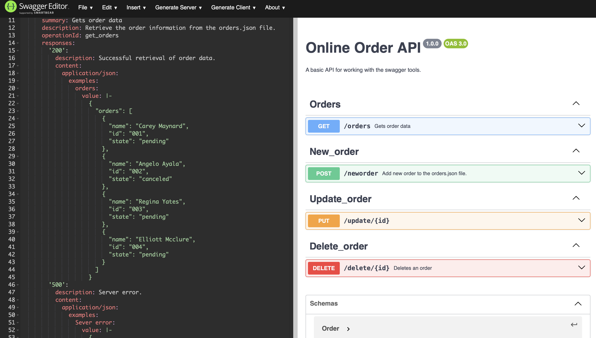

!!! note ""
    Good API documentation accelerates developer onboarding and reduces the burden on support teams. The examples in this section demonstrate a design-first approach to API documentation — beginning with a formal OpenAPI specification before implementation, ensuring that the contract between the API and its consumers is clearly defined from the outset. Each example showcases structured endpoint documentation, request and response schemas, and practical cURL references intended to serve developers at the point of need.

# Online Order API

[](LICENSE)


---

A simple CRUD API built using **Node.js**, **Express**, and documented with **Swagger / OpenAPI 3.0**.  
This project demonstrates designing an API specification *first* with Swagger, then implementing the backend server that follows it.



---

## Before you start

**Who this is for:** developers who want to run the API locally and try each endpoint from the command line.

**You'll need:**

- Node.js 18 or later
- `curl` (or any HTTP client)
- About 5 minutes

**Run the server:**

```bash
git clone https://github.com/james-glass1999/online-order-api.git
cd online-order-api
npm install
node server.js
```

The server listens on `http://localhost:3000`. All request and response bodies are JSON.

!!! note "About the endpoint names"
    The paths (`/neworder`, `/update/{id}`, `/delete/{id}`) are deliberately literal so each operation is obvious in a first walkthrough. A production API would use resource-based paths: `POST /orders`, `PUT /orders/{id}`, and `DELETE /orders/{id}`.

---

## Project Overview

This API allows you to:

- Retrieve all orders (`GET /orders`)
- Add a new order (`POST /neworder`)
- Update an order (`PUT /update/{id}`)
- Delete an order (`DELETE /delete/{id}`)

Data is stored in a simple JSON file (`orders.json`), making it easy to understand without needing a database.

---

## OpenAPI Specification

A full OpenAPI 3.0 specification is available here:

**[openapi.yaml](openapi.yaml)**

---

## Features

- Node.js + Express backend  
- Full OpenAPI/Swagger specification  
- CRUD operations on order data  
- Example request bodies and responses  
- Documented error responses  
- Tested with cURL  
- Hosted on GitHub  

---

## Tech Stack

- **Node.js**
- **Express.js**
- **Swagger / OpenAPI 3.0**
- **JSON file-based storage**

---

## API Endpoints

| Method | Endpoint        | Description             |
|--------|-----------------|-------------------------|
| GET    | `/orders`       | Get all orders          |
| POST   | `/neworder`     | Create a new order      |
| PUT    | `/update/{id}`  | Update an order         |
| DELETE | `/delete/{id}`  | Delete an order by ID   |

---

## The Order object

| Field   | Type   | Required | Description                                                     |
|---------|--------|----------|-----------------------------------------------------------------|
| `id`    | string | Yes      | Unique order ID, for example `"005"`.                           |
| `name`  | string | Yes      | Customer name.                                                  |
| `state` | string | Yes      | Order status, for example `pending`, `complete`, or `canceled`. |

---

## Endpoint reference

### Get all orders

`GET /orders`

Returns every order in the data store.

**Request**

```bash
curl http://localhost:3000/orders
```

**Response — `200 OK`**

```json
{
  "orders": [
    { "name": "Carey Maynard", "id": "001", "state": "pending" },
    { "name": "Angelo Ayala", "id": "002", "state": "canceled" }
  ]
}
```

**Errors**

| Status | Body | When |
|--------|------|------|
| `500 Internal Server Error` | `{ "error": "An unexpected error occurred." }` | The data file can't be read. |

---

### Create an order

`POST /neworder`

Adds a new order. All three fields of the [Order object](#the-order-object) are required.

**Request**

```bash
curl -H "Content-Type: application/json" \
     -d '{"name": "John Smith", "id": "005", "state": "pending"}' \
     http://localhost:3000/neworder
```

**Response — `201 Created`**

```json
{
  "message": "Order added successfully.",
  "order": { "name": "John Smith", "id": "005", "state": "pending" }
}
```

**Errors**

| Status | Body | When |
|--------|------|------|
| `400 Bad Request` | `{ "error": "Missing required fields." }` | `name`, `id`, or `state` is missing or empty. |

---

### Update an order

`PUT /update/{id}`

Updates an existing order. The `id` in the path identifies the order and takes precedence over any `id` in the body.

| Path parameter | Type   | Description                |
|----------------|--------|----------------------------|
| `id`           | string | ID of the order to update. |

**Request**

```bash
curl -X PUT \
     -H "Content-Type: application/json" \
     -d '{"name": "Carey Maynard", "id": "001", "state": "complete"}' \
     http://localhost:3000/update/001
```

**Response — `200 OK`**

```json
{
  "message": "Order updated.",
  "order": { "name": "Carey Maynard", "id": "001", "state": "complete" }
}
```

**Errors**

| Status | Body | When |
|--------|------|------|
| `404 Not Found` | `{ "error": "Order with the specified ID was not found." }` | No order has that ID. |

---

### Delete an order

`DELETE /delete/{id}`

Removes an order permanently.

| Path parameter | Type   | Description                |
|----------------|--------|----------------------------|
| `id`           | string | ID of the order to delete. |

**Request**

```bash
curl -X DELETE http://localhost:3000/delete/002
```

**Response — `200 OK`**

```json
{ "message": "Order deleted successfully." }
```

**Errors**

| Status | Body | When |
|--------|------|------|
| `404 Not Found` | `{ "error": "Order with the specified ID was not found." }` | No order has that ID. |

---

## Errors at a glance

All errors return a JSON body with a single `error` field.

| Status | Meaning | Returned by |
|--------|---------|-------------|
| `400 Bad Request` | The request body is missing a required field. | `POST /neworder` |
| `404 Not Found` | No order matches the `id` in the path. | `PUT /update/{id}`, `DELETE /delete/{id}` |
| `500 Internal Server Error` | The server couldn't read the data store. | `GET /orders` |

---

## Example Code (server.js)

```js
const express = require('express');
const fs = require('fs');

const server = express();
server.use(express.json());

const DATA_FILE = 'orders.json';
const load = () => JSON.parse(fs.readFileSync(DATA_FILE, 'utf8'));
const save = (data) => fs.writeFileSync(DATA_FILE, JSON.stringify(data, null, 2));
const REQUIRED = ['name', 'id', 'state'];

// GET all orders
server.get('/orders', (req, res) => {
  try {
    res.status(200).json(load());
  } catch (err) {
    res.status(500).json({ error: 'An unexpected error occurred.' });
  }
});

// POST new order
server.post('/neworder', (req, res) => {
  const order = req.body || {};
  if (!REQUIRED.every((f) => typeof order[f] === 'string' && order[f].length)) {
    return res.status(400).json({ error: 'Missing required fields.' });
  }
  const data = load();
  data.orders.push(order);
  save(data);
  res.status(201).json({ message: 'Order added successfully.', order });
});

// PUT update an order
server.put('/update/:id', (req, res) => {
  const data = load();
  const order = data.orders.find((o) => o.id === req.params.id);
  if (!order) {
    return res.status(404).json({ error: 'Order with the specified ID was not found.' });
  }
  Object.assign(order, req.body, { id: req.params.id });
  save(data);
  res.status(200).json({ message: 'Order updated.', order });
});

// DELETE an order
server.delete('/delete/:id', (req, res) => {
  const data = load();
  const remaining = data.orders.filter((o) => o.id !== req.params.id);
  if (remaining.length === data.orders.length) {
    return res.status(404).json({ error: 'Order with the specified ID was not found.' });
  }
  save({ orders: remaining });
  res.status(200).json({ message: 'Order deleted successfully.' });
});

server.listen(3000, () => console.log('Listening on http://localhost:3000'));
```

```
# Project Structure
├── server.js             # Express server and routes
├── orders.json           # Data store
├── openapi.yaml          # OpenAPI (Swagger) specification
├── new_order.json        # Sample POST body
├── README.md
└── LICENSE
```

## Summary

This project demonstrates a complete design-first approach to API development using:

- Swagger Editor  
- OpenAPI 3.0  
- Express.js  
- JSON data storage  

It showcases how modern APIs can be designed, documented, and implemented from a formal API contract.
